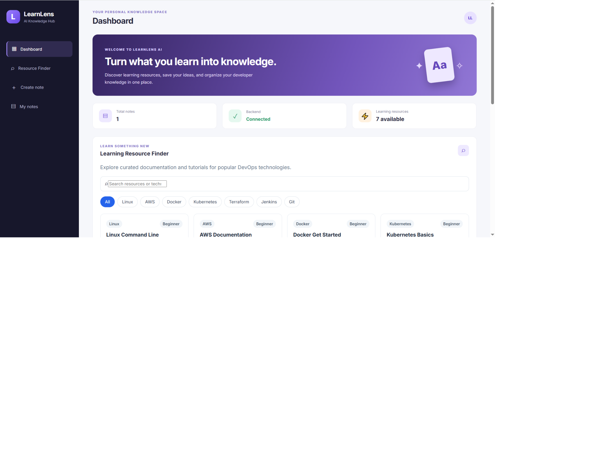
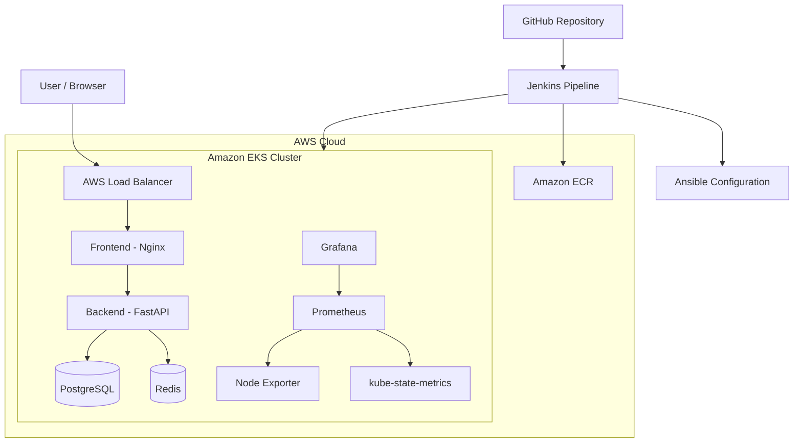
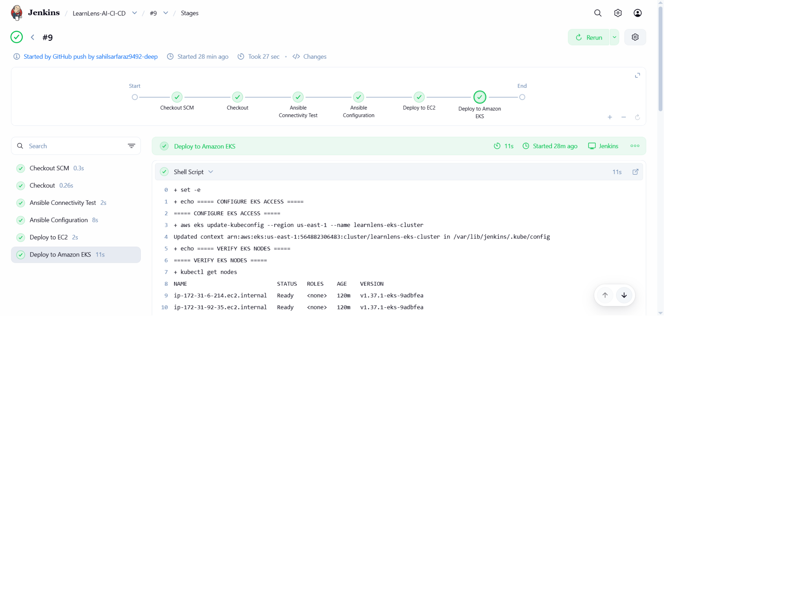
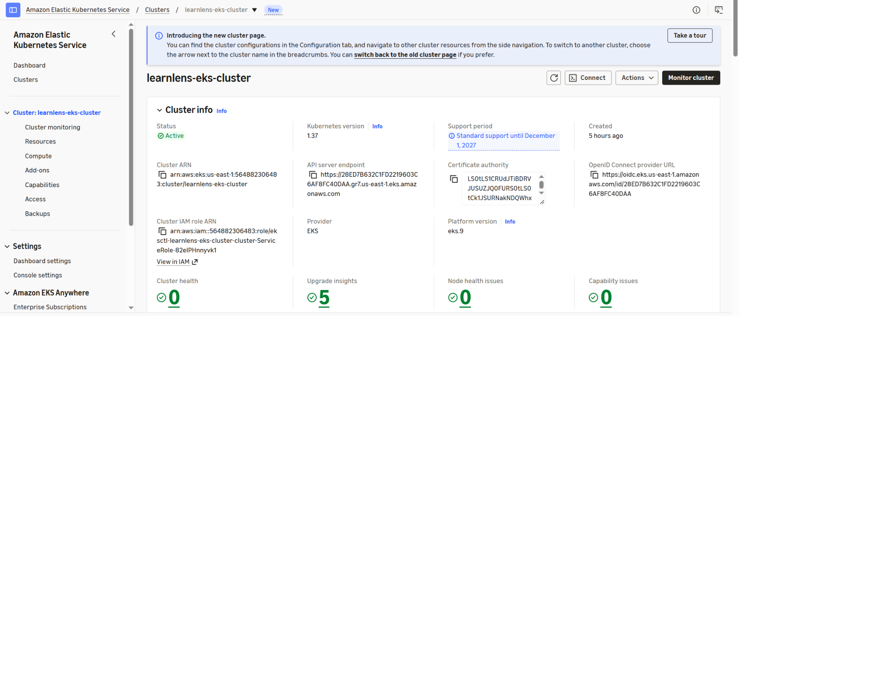
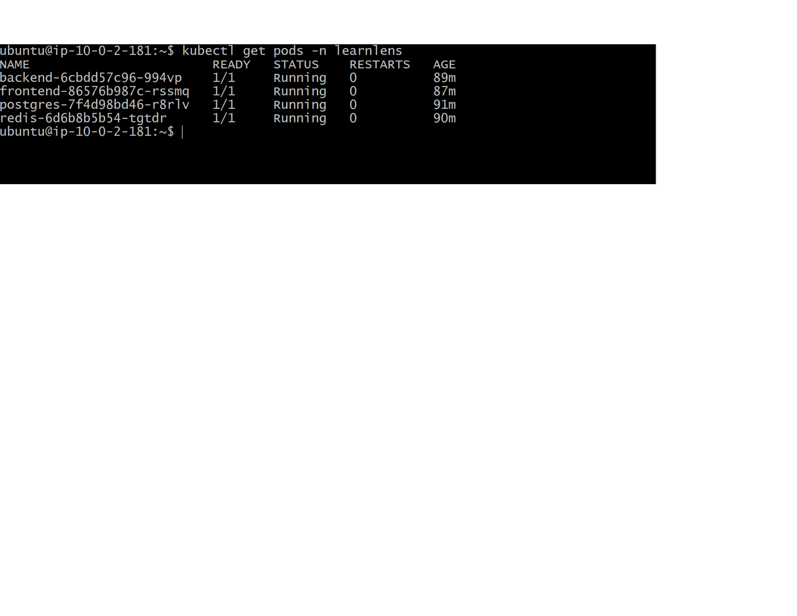
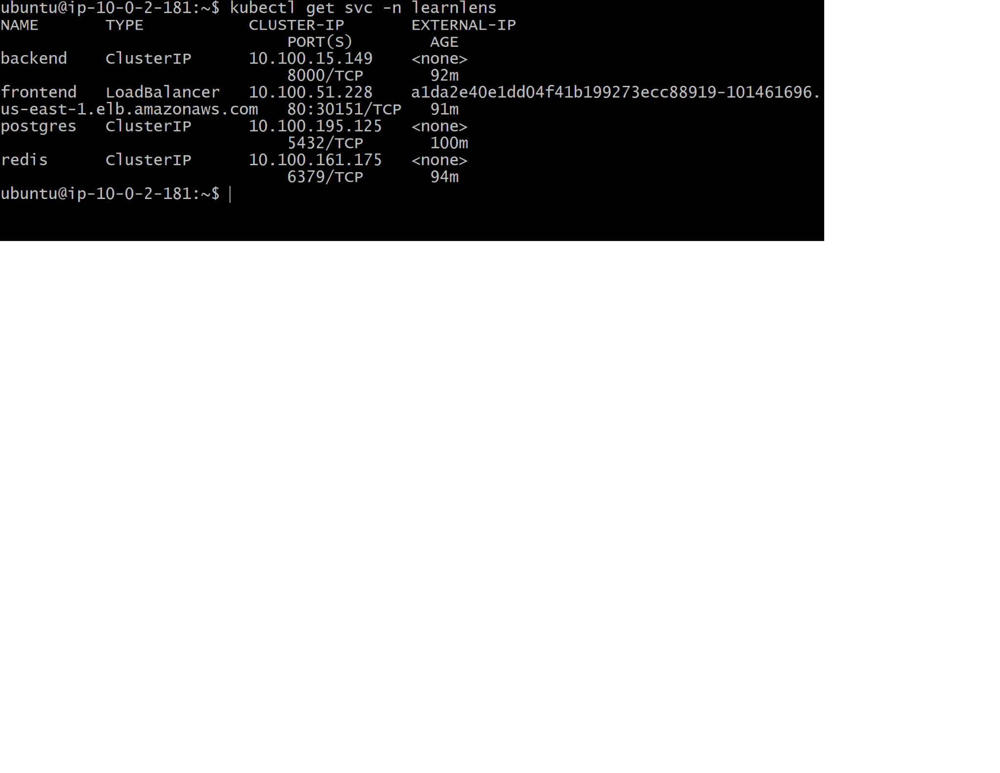
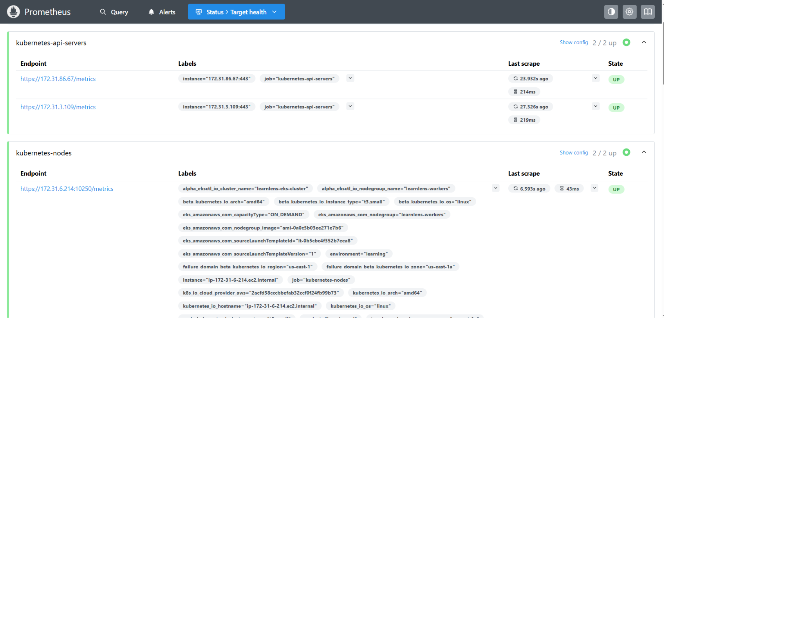
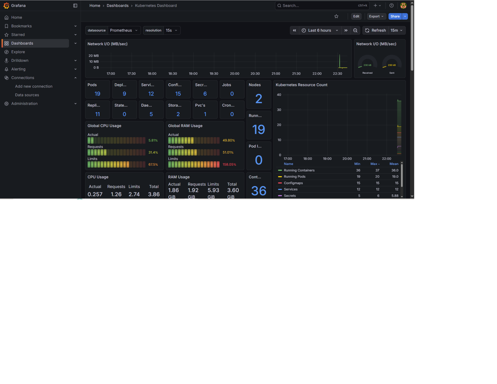

<div align="center">

# LearnLens AI

### An AI Knowledge Hub for Learning, Organizing, and Discovering Technical Resources

<p>
  
  
  
  
  
  
  
  
</p>

**A full-stack learning application deployed through an automated DevOps workflow on AWS.**

</div>

---

## Project Overview

LearnLens AI is a learning and knowledge-management web application built to help users discover technical learning resources and organize personal notes in one place.

This repository also demonstrates an end-to-end DevOps implementation: containerization, infrastructure automation, configuration management, Jenkins CI/CD, Amazon EKS deployment, persistent database storage, and Kubernetes monitoring.

## Application Preview



### Application capabilities

- Learning dashboard with application and backend status.
- Learning Resource Finder with curated technical resources.
- Resource categories covering Linux, AWS, Docker, Kubernetes, Terraform, Jenkins, and Git.
- Create and manage personal learning notes.
- Backend API connected to PostgreSQL and Redis.

> The repository demonstrates the application features implemented in this project. Advanced AI capabilities such as semantic search, embeddings, or automated video transcription are not claimed as implemented here.

## Technology Stack

| Area | Technologies |
|---|---|
| Frontend | React, TypeScript, Nginx |
| Backend | Python, FastAPI |
| Database | PostgreSQL with pgvector image |
| Cache / service | Redis |
| Containers | Docker, Docker Compose |
| Cloud | AWS EC2, Amazon EKS, Amazon ECR, Elastic Load Balancing |
| Infrastructure as Code | Terraform |
| Configuration Management | Ansible |
| CI/CD | Jenkins, GitHub |
| Orchestration | Kubernetes, Helm |
| Monitoring | Prometheus, Grafana, Node Exporter, kube-state-metrics |

## Architecture



## DevOps Implementation

### 1. Infrastructure as Code — Terraform

- Used Terraform to define and manage AWS infrastructure for the project.
- Kept infrastructure configuration in the repository's `terraform/` directory.

### 2. Configuration Management — Ansible

- Used Ansible to configure the application EC2 environment.
- Organized automation using inventory and playbook/role structure.

### 3. Containerization — Docker

- Containerized the frontend and backend services.
- Used Docker Compose for the EC2 application deployment workflow.

### 4. CI/CD — Jenkins

The Jenkins pipeline automates the application delivery workflow from source checkout through EC2 and EKS deployment.



Pipeline stages shown in the successful run:

1. Checkout SCM
2. Checkout
3. Ansible Connectivity Test
4. Ansible Configuration
5. Deploy to EC2
6. Deploy to Amazon EKS

### 5. Container Registry — Amazon ECR

- Built and pushed frontend and backend container images to Amazon ECR.
- Kubernetes deployments pull the published images from ECR.

### 6. Container Orchestration — Amazon EKS

The application runs in an Amazon EKS cluster using Kubernetes Deployments, Services, and persistent storage for PostgreSQL.



#### Kubernetes workloads



The application namespace contains the following workloads:

| Component | Kubernetes resource | Purpose |
|---|---|---|
| Frontend | Deployment + LoadBalancer Service | Serves the web interface |
| Backend | Deployment + ClusterIP Service | FastAPI application |
| PostgreSQL | Deployment + ClusterIP Service + PVC | Persistent application data |
| Redis | Deployment + ClusterIP Service | Cache / supporting service |

#### Kubernetes services



The frontend is exposed through an AWS LoadBalancer Service. Backend, PostgreSQL, and Redis use internal ClusterIP services.

### 7. Monitoring — Prometheus and Grafana

Prometheus collects Kubernetes metrics. Node Exporter and kube-state-metrics provide node and Kubernetes object metrics. Grafana visualizes the collected metrics.

#### Prometheus target health



The captured Prometheus page shows:
- Kubernetes API servers: 2/2 targets UP.
- Kubernetes nodes: 2/2 targets UP.

#### Grafana Kubernetes dashboard



The dashboard displays cluster and workload information, including:
- Node and pod counts.
- CPU and memory usage.
- Kubernetes resources and container counts.
- Network I/O metrics.

## Deployment Verification

The following checks were completed during the project deployment:

| Verification | Observed result |
|---|---|
| Jenkins pipeline | Successful |
| Amazon EKS cluster | Active |
| EKS worker nodes | 2 nodes Ready |
| Application pods | Backend, frontend, PostgreSQL, and Redis Running |
| Pod restarts | 0 in the captured verification |
| Frontend service | AWS LoadBalancer provisioned |
| Application health endpoint | Healthy; database and Redis connected |
| Prometheus targets | 2/2 API server and 2/2 node targets UP |
| Grafana | Kubernetes dashboard displaying metrics |
| Database persistence | Test note remained after browser refresh |

## Repository Structure

```text
LearnLens-AI/
├── ansible/
├── backend/
├── frontend/
├── k8s/
│   ├── backend.yaml
│   ├── frontend.yaml
│   ├── gp3-storageclass.yaml
│   ├── postgres-pvc.yaml
│   ├── postgres.yaml
│   └── redis.yaml
├── terraform/
├── Jenkinsfile
├── docker-compose.yml
├── .env.example
├── .gitignore
└── README.md
```

## Run Locally

Clone the repository:

```bash
git clone https://github.com/sahilsarfaraz9492-deep/learnlens-ai.git
cd learnlens-ai
```

Configure the environment using the example file and provide your own local development values. Do not commit real credentials or `.env` files.

Start the application with Docker Compose:

```bash
docker compose up -d --build
```

Check running containers:

```bash
docker compose ps
```

Stop the local application:

```bash
docker compose down
```

Refer to the application and Compose configuration in the repository for the exact environment variables and service settings.

## Kubernetes Deployment

The Kubernetes manifests are in the `k8s/` directory. After configuring AWS credentials and `kubectl` access to your own EKS cluster, create the namespace and apply the manifests:

```bash
kubectl create namespace learnlens
kubectl apply -f k8s/
kubectl get pods -n learnlens
kubectl get services -n learnlens
```

Create the Kubernetes Secret required by the PostgreSQL and backend manifests before deploying, using your own secure values. Do not store database passwords in Git.

## Security and Cost Notes

- Do not commit `.env` files, Kubernetes Secrets, kubeconfig files, private keys, Terraform state, or credentials.
- Use IAM roles and least-privilege permissions for AWS access.
- The demo EKS cluster, worker nodes, and AWS LoadBalancer can incur charges while running. Review and remove temporary resources when the demo is finished.
- The monitoring setup uses in-cluster services; Grafana and Prometheus are not exposed publicly by this project configuration.

## Author

**Muhammad Sahil Sarfaraz**

- GitHub: [@sahilsarfaraz9492-deep](https://github.com/sahilsarfaraz9492-deep)
- Project repository: [LearnLens AI](https://github.com/sahilsarfaraz9492-deep/learnlens-ai)

---

<div align="center">

**LearnLens AI — Learn, organize, and grow your technical knowledge.**

</div>
